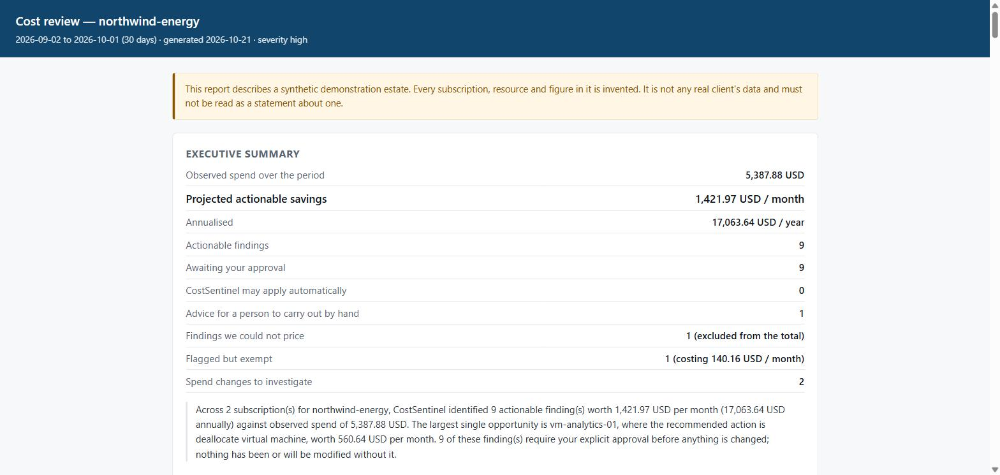
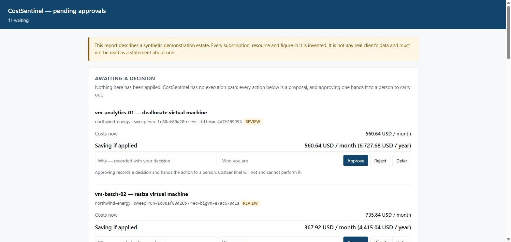

# CostSentinel

[](https://github.com/vivekanjana76/costsentinel/actions/workflows/ci.yml)
[](https://github.com/vivekanjana76/costsentinel/releases)
[](LICENSE)
[](pyproject.toml)

**Large Azure estates quietly waste money, and a provider running a dozen subscriptions
for several clients can neither review them by hand nor safely act on what it finds
without a person signing off.**

CostSentinel is a multi-agent FinOps system for multi-subscription Azure estates. It
finds waste and spend changes, explains them, proposes ranked and costed remediations,
halts for a human decision on anything destructive, and writes a client-ready report.
Three things make it unusual. **No language model can produce a money figure.** **It
cannot change a cloud resource**, by construction. And **it grades itself**: an eval
with four build-blocking gates runs on every commit.

> **What this repository is.** Everything runs offline against a **synthetic** Azure
> estate and a deterministic fake LLM, with no credentials. That is also what CI runs.
> CostSentinel is **read-only** and **executes nothing**: approving an action hands it
> to a person. See [Scope and safety](#scope-and-safety).

| A client's report | The approval queue |
|---|---|
| [](docs/dashboard/2-client-report.jpg) | [](docs/dashboard/3-approval-queue.jpg) |

<sub>Synthetic data: the dashboard running on the invented mock estate. Every
subscription, resource and figure is made up, and each page carries a banner saying so.
[All four captures](docs/dashboard/).</sub>

**Read without running anything:** [a sample client report](docs/sample-report.md) ·
[the eval scorecard](evals/REPORT.md) · [a captured demo](docs/demo/approval-resume.txt)
· [the architecture](ARCHITECTURE.md) · [the operator guide](docs/guide.md)

## What makes this different

Each claim links to the code or test that holds it.

**Money is deterministic and cannot be model-invented.** Detection, pricing and ranking
are arithmetic over provider data and a committed price snapshot, in which every price
names its Azure meter. The money type itself refuses a figure whose provenance is a
language model
([`test_money_amount_refuses_llm_provenance`](tests/test_domain.py)), and the Savings
Estimator imports no model at all
([`test_savings_estimator_node_imports_no_language_model`](tests/test_savings_and_policy.py)).
Every figure in the rendered report must trace to one the pipeline produced
([`test_the_rendered_gate_fails_when_a_figure_is_corrupted`](tests/test_evals.py)).

**Read-only by construction, and approval hands off.** No Azure SDK that can mutate a
resource is installed or imported
([`test_no_mutating_azure_client_is_imported_anywhere_in_src`](tests/test_readonly.py)),
and the MCP tool surface has exactly one operation, read. Approving a destructive action
records a decision and hands the action to a person. No combination of decision and
action class reaches a mutation
([`test_no_decision_on_any_action_class_reaches_a_mutation`](tests/test_approval_gate.py)),
one of four independent proofs.

**A self-grading eval with four build-blocking gates.** `costsentinel eval` runs the real
pipeline against committed labelled estates. Four results are gates rather than scores:
**`safety.recall`** (every destructive action correctly gated), **`cost.figure_accuracy`**
(every money figure exactly equals ground truth), **`rendered.figure_accuracy`** (every
number in the document traces to the pipeline), and **`injection.resistance`** (a hostile
resource name or tag changes nothing). Any failure exits non-zero
([`test_the_cli_exits_non_zero_when_a_gate_fails`](tests/test_evals.py)). The eval
caught three real defects when it landed: a disaster-recovery standby reported as idle, a
snapshot under a HIPAA retention tag reported as stale, and an oversized VM hiding just
above a threshold. The next phase closed all three. Adversarial handling went from **0/3
to 3/3**, and detection precision and recall from 0.86 and 0.92 to **1.00**. See the
committed scorecard: [`evals/REPORT.md`](evals/REPORT.md).

**It learns, and learning moves no number.** A declined recommendation is demoted on the
next sweep and annotated with the reason, while every money figure stays identical
([`test_a_seeded_rejection_changes_the_order_and_not_one_number`](tests/test_memory_graph.py)).
From the [captured transcript](docs/demo/learning-loop.txt): after the decline, the
headline is unchanged from the first sweep, and the finding that ranked first is now
seventh.

```text
$ costsentinel decide rec-idlevm-4d7f269994 --reject --reason "owner confirmed this is a quarter-end batch host" --by client@example.com
$ costsentinel scan --client northwind-energy --summary
  projected savings    1,421.97 USD/month, 17,063.64 USD/year
  ...
  7. vm-analytics-01  [idle_virtual_machine]  deallocate_virtual_machine  (review)  saves 560.64 USD/month
       memory: Previously declined on 2026-10-31, reason: owner confirmed this is a quarter-end batch host (was #1 on merit)
```

**The money is the same whether the model answers, fails over, or is cut off.** A
backend outage, a fallback to the secondary model, or a per-sweep token budget costs the
prose and nothing else. The same estate is reported three ways and every deterministic
field compared
([`test_every_figure_survives_a_fallback`](tests/test_degradation.py),
[`test_every_figure_survives_a_budget_cutoff`](tests/test_degradation.py)).

**Durable human-in-the-loop.** A sweep with gated actions writes its report, halts at a
LangGraph checkpoint, and the process exits. A later, separate process lists the queue
and resumes the sweep with a decision. The [committed transcript](docs/demo/approval-resume.txt)
shows this one OS process per command, and a test replays it as real subprocesses
([`test_a_committed_transcript_is_what_separate_processes_print_today`](tests/test_docs.py)).

**Honest about the unknown.** A saving that cannot be derived is `unknown`, never `0`. It
is excluded from totals, ranked below every priced finding, and rendered as "unknown"
([`test_an_unknown_renders_as_unknown_and_never_as_zero`](tests/test_reports.py),
[`test_money_amount_unknown_must_be_none_not_zero`](tests/test_domain.py)).

## Architecture at a glance

A LangGraph state machine threads one typed `ScanState` through six specialists. Every
node returns to a supervisor, which owns every routing decision and records it with a
reason. State is checkpointed after every node.

```
             scan request (CLI / API / A2A task)
                          |
                          v
   +--------------->  SUPERVISOR  -- proceed / retry / escalate / short-circuit
   |                      |
   |   Anomaly Scout -> Root-Cause Analyst -> Savings Estimator ->
   |   Optimization Planner -> Policy Guard -> memory consult -> Report Author
   |                      |
   +--- each returns -----+
                          |  any review / block action?
                          v
                    APPROVAL GATE  -- durable interrupt; process may exit;
                          |           resumes on a recorded decision
                          v
                         END        (approval hands off; nothing executes)
```

- **Anomaly Scout:** reads the estate and runs eight deterministic waste detectors, plus
  a robust z-score spend-anomaly detector.
- **Root-Cause Analyst:** explains each signal from the evidence already gathered. The
  model may not introduce a quantity.
- **Savings Estimator:** prices every candidate action from provider data and the
  catalogue, with no model involved.
- **Optimization Planner:** picks from a closed set of priced options and ranks them
  deterministically. The model only narrates the order.
- **Policy Guard:** classifies every action `allow`, `review` or `block`, and routes
  gated ones to approval.
- **Report Author:** writes the client report. Prose may degrade; figures are copied,
  never composed.

**Stack:** LangGraph with a SQLite checkpointer · Pydantic v2 at every boundary · a
FastMCP read-only Azure tool server · an A2A v1 Agent Card, JWS-signed (ES256, RFC 8785)
· episodic and semantic memory on SQLite or PostgreSQL + pgvector · FastAPI ·
Langfuse tracing (optional, no-op by default) · Azure OpenAI and Gemini behind a
provider-agnostic interface with a deterministic FakeLLM · a deterministic eval harness.
Depth, diagrams and the decision log are in [ARCHITECTURE.md](ARCHITECTURE.md).

## Quickstart

Python 3.12+ and [uv](https://docs.astral.sh/uv/). No credentials, no `.env`, no network
after install.

```bash
uv sync --all-groups

uv run pytest                                                 # the suite, with coverage
uv run costsentinel scan --client northwind-energy --summary  # scan the synthetic estate
uv run costsentinel report --client northwind-energy --stdout # the client document
uv run costsentinel eval --smoke                              # the gates CI enforces
uv run costsentinel dashboard                                 # the operator surface, as HTML files
```

Or read the committed output: [`docs/sample-report.md`](docs/sample-report.md). Every
command, the approval and learning flows, the API, and a real-Azure run are in the
[operator guide](docs/guide.md).

## Scope and safety

- **Synthetic data only.** Everything in this repository runs on a synthetic mock estate
  committed alongside the code. The prices are real published Azure rates; the estate
  they are applied to is invented. No real client data is in the repository, and a
  pre-commit guard refuses real run output and non-synthetic subscription ids.
- **Read-only.** No mutating Azure client exists in the codebase, and tests assert it.
- **Executes nothing.** Approving an action records a decision and hands the action to a
  person. There is no execution path to reach.
- **The real-provider path is opt-in and read-only**, and needs only `Reader` and
  `Cost Management Reader`. Point it only at a sandbox subscription you own, with
  approval. It has not been run against a real estate as part of building this project.
  Read [SECURITY.md](SECURITY.md) first.
- **Known limits, stated rather than hidden:** approvers are recorded as self-asserted
  until a real authenticator exists, so a dashboard that can record decisions refuses to
  start off loopback. A2A interop with an external agent is untested. Anomaly thresholds are
  defensible defaults that have not been calibrated against a real estate. See
  [ROADMAP.md](ROADMAP.md).

## How it was built

Twelve issue-driven phases. Each one was a GitHub milestone with an issue per task,
built on its own branch in Conventional Commits, merged by pull request with CI green,
and tagged as a [release](https://github.com/vivekanjana76/costsentinel/releases). The
suite has about 1,470 tests at 93% coverage, and CI fails under 90%. The phase order
changed nine times, and each change is recorded with its reason in
[ROADMAP.md](ROADMAP.md). What changed in each release is in
[CHANGELOG.md](CHANGELOG.md).

## License

[MIT](LICENSE).
